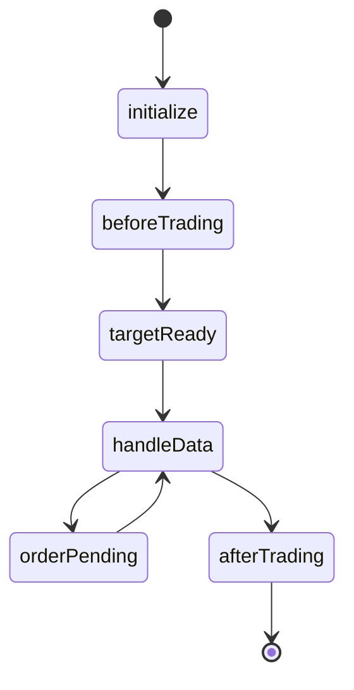

# 05：PTrade 事件驱动部署设计

> 日线脚本在 `ptrade/fundamental_low_turnover.py`。它按 PTrade 的 `initialize`、`before_trading_start`、`handle_data` 和 `after_trading_end` 执行，盘前读取研究侧导出的排名。研究进程不下单。本章的状态机和验收清单仍然用于上线前检查。

## 📖 【核心理论与量化直觉】

研究回测是按完整历史表计算；交易终端是一个随时间推进的事件系统。两者的接口必须是“目标组合”，而不是把 Pandas 回测循环复制到终端。

建议的日内生命周期：



- `initialize`：注册标的、频率、账户与持久化键；不拉取大历史数据。
- `before_trading_start`：读取上一交易日研究快照，校验日期、代码、目标权重和风控开关，生成目标持仓。
- `handle_data`：读取账户、委托、成交和可交易状态；先处理风控卖出，再进行调仓买卖。
- `after_trading_end`：记录订单、成交、持仓、现金、异常和下一日可恢复的状态。

目标股数需要经过价格、可用现金和整手约束。$q_i$ 是目标股数，$E$ 是权益，$w_i$ 是目标权重，$P_i$ 是价格：

$$
q_i=100\left\lfloor\frac{E\cdot w_i}{100\cdot P_i}\right\rfloor
$$

下单量为目标股数减去当前可用股数。卖出必须考虑可卖数量和 T+1；买入必须预留佣金和滑点缓冲。订单是异步状态机，不是函数返回即成交。

## ⚠️ 【实盘避坑指南】

- 本地研究数据为 T-1，不能在盘中当作实时行情。PTrade 端的实时价格、账户和可卖数量应由终端 API 提供。
- 研究侧 token、券商账户和终端密码均不进入源码、快照或日志。参见 [PTrade 开通说明](../ptrade/PTrade开通与下载.md) 的本机配置边界。
- 重启、回调重复和网络重连都会让同一信号重复触发。每一笔意图需要 `trade_date + ts_code + side + target_shares` 的幂等键。
- 订单已报、部分成交、撤单、拒单、涨跌停、停牌和可用股数不足是正常状态，不能假设“一次下单=全部成交”。
- 先卖后买可释放现金；若多个卖单未成交就发买单，可能造成现金不足或风险暴露翻倍。
- 实盘前必须使用仿真账户连续运行，并将成交回报与日终持仓对账。回测中的止损价不能保证在真实盘口成交。
- PTrade API 的准确函数签名和事件名称以券商终端版本附带的 API 文档为准；不要从网上其他券商版本复制接口。

## 💻 【仓库代码实战导引】

现有可参考材料：

- [ptrade/__init__.py](../../ptrade/__init__.py)：当前阶段边界声明。
- [docs/ptrade/PTrade开通与下载.md](../ptrade/PTrade开通与下载.md)：客户端、仿真/生产环境和文档入口。
- [strategy/publish.py](../../strategy/publish.py)：`publish` 写出持仓快照，是研究侧向交易侧交接的候选格式。
- [strategy/risk_control.py](../../strategy/risk_control.py)：月末组合、止损和指数仓位规则，应被提炼为无券商依赖的目标组合输入。

当前可安全执行的是研究与回测验证：

```bash
pytest -q
python -m strategy.publish --asof YYYYMMDD --top 8
python -m backtest.engine --start YYYYMMDD --end YYYYMMDD
```

阶段四创建事件脚本后，建议最小接口分为 `load_target_snapshot`、`reconcile_positions`、`build_orders`、`submit_orders`、`record_execution`。其中前三个必须可用纯 Python 合成账户数据测试；只有 `submit_orders` 依赖 PTrade 运行时。

## 📊 【实验复现与指标预期】

部署前的可验收输出应是一份不可变的“交易意图”表，至少有：

| 字段 | 含义 |
| --- | --- |
| `trade_date` | 信号生效的交易日 |
| `ts_code` | 标的代码与市场后缀 |
| `target_weight` | 风控后的目标权重 |
| `target_shares` | 按整手、现金约束后的目标股数 |
| `reason` | `rebalance`、`hard_stop`、`atr_stop` 或 `risk_off` |
| `signal_id` | 用于幂等与审计的唯一键 |

仿真验收至少覆盖五个场景：重复事件不会重复下单、卖出释放现金后才买入、部分成交能继续对账、拒单会记录并降级、重启后能从持久化状态恢复。指标不只看收益；还应统计订单拒绝率、未完成目标权重、成交偏离、异常恢复次数和日终对账差异。

当前仓库不应显示“下单成功”的控制台预期，因为对应脚本尚未实现。实现阶段应先给纯函数和合成回报加测试，再接终端仿真 API。

## 🧠 【本章实操挑战题】

1. 新建一个不依赖 PTrade 的 `build_orders` 原型：输入目标权重、价格、现金和当前持仓，输出整手买卖清单。为现金不足和可卖股数不足各写一个单元测试。
2. 为未来状态持久化设计一份 JSON 或 SQLite 记录：保存 `signal_id`、订单状态、已成交数量和更新时间。模拟进程在“部分成交后”重启，验证恢复后不会重复提交已成交部分。
