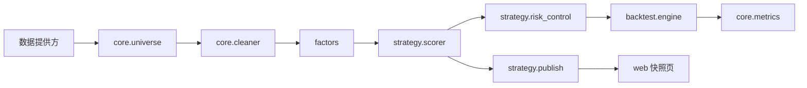

# quant-lab 实战学习手册

这套手册以仓库当前代码为准，目标是把 A 股小资金研究流程做成可复现、可审计的工程：数据在当时可见，因子只在截面内比较，组合受到仓位与交易摩擦约束，最后才进入仿真和实盘。

## 学习路径

1. [01 点时数据与排雷](01_pit_data_and_cleaner.md)：先建立不会偷看未来的数据边界。
2. [02 因子工程](02_factor_engineering.md)：把财报与行情加工成可比较的截面特征。
3. [03 多因子打分](03_multi_factor_scoring.md)：融合因子、选出 Top-N，并理解如何补做 Rank IC 验证。
4. [04 风控与回测](04_risk_control_and_backtest.md)：加入止损、仓位控制和真实交易成本，读懂绩效指标。
5. [05 PTrade 部署](05_ptrade_deployment.md)：设计研究侧到事件驱动实盘的交接。该章是阶段四设计，当前没有可下单脚本。

每章均按五个固定板块编排：核心理论、实盘避坑、仓库实战、实验预期和挑战题。顺序不可颠倒；后续模块依赖前面模块的时间边界。

## 环境准备

Python 版本要求为 3.11 或更高。项目根目录执行：

```bash
pip install -e ".[dev,web]"
pytest -q
```

测试使用合成数据，不访问网络；通过后再进行需要历史行情的命令。山西证券数据网关凭据只保存在根目录 `.env` 的 `SXSC_TUSHARE_TOKEN`，不要写入 Markdown、脚本、终端历史或提交记录。本地研究默认使用 `env=prd`，数据为 T-1 历史数据。

## 常用运行入口

```bash
# 构建某一截面的可投资股票池
python -m core.universe --asof YYYYMMDD

# 对排雷后的股票打分，取 5–8 只
python -m strategy.scorer --asof YYYYMMDD --top 8

# 写出网页可读快照
python -m strategy.publish --asof YYYYMMDD --top 8
streamlit run web/app.py

# 月末调仓、日频止损的本地回测
python -m backtest.engine --start YYYYMMDD --end YYYYMMDD
```

这些命令会读取数据提供方并使用本地缓存 `data/cache/`。回测仅是历史情景模拟：它没有实时行情、涨跌停、停复牌成交概率和市场冲击模型，因此不构成收益承诺。

## 模块调用地图



## 当前边界

- 已实现：点时排雷、基本面截面因子、固定权重打分、月末回测、ATR/硬止损、指数均线降仓和交易成本。
- 未实现：Rank IC 批量研究脚本、滚动样本外检验、PTrade 事件脚本、真实订单状态管理与实盘下单。
- 账户规模为 4 万元时，单笔最低佣金和整手约束的影响很大。策略目标应首先看最大回撤与卡玛比率，再讨论年化收益。
